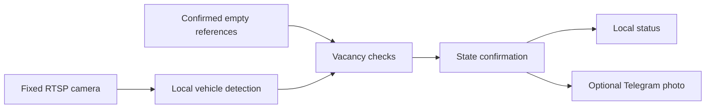

# Parking Watch

Local monitoring of parking spaces from a fixed RTSP camera, with optional Telegram photo notifications.

Parking Watch analyses video on your computer. A missed vehicle detection is **not** treated as an empty space: vacancy also requires a match against a visually confirmed empty reference of the same camera view.

## Features

- Separate regions, names, references and states for each parking space.
- Vehicle segmentation, contrast enhancement and a larger fallback model for difficult frames.
- Empty-reference checks for both pixel difference and ground texture.
- Confirmation windows and notification filtering to reduce transient alerts.
- Telegram photos, `/check`, and macOS background services with credentials in Keychain.



## States

| State | Meaning |
| --- | --- |
| Occupied | A vehicle overlaps the configured region sufficiently. |
| Free | Low obstruction and a matching confirmed empty reference persist through the confirmation window. |
| Unknown | The image cannot establish either state, or an empty reference is missing. |
| Offline | Fresh camera frames are unavailable. |

## Quick start

Python 3.11–3.13 is supported by the package. The macOS installer uses Python 3.12 and prepares separate environments for Apple Silicon and Intel.

```sh
git clone https://github.com/kovallux/parking-watch.git
cd parking-watch
cp config.example.json config.local.json
```

Edit `config.local.json` with your camera address and parking polygons. The supplied address is a documentation placeholder; the polygons are examples, not a calibration.

For macOS setup and Telegram pairing, follow [Setup](START-HERE.md). To move an existing installation, see [Moving to another Mac](ПЕРЕНОС-НА-ДРУГОЙ-MAC.md).

For an offline image check, install dependencies with `uv sync --python 3.12`, then run:

```sh
uv run parking-watch --config config.local.json image /path/to/camera-frame.jpg --output data/check.jpg
```

Camera access can use the configured macOS Keychain entry or a `CAMERA_RTSP_URL` supplied in the process environment. Do not put access credentials in tracked configuration or command examples.

## Configuration and references

`config.example.json` documents the main options. Each entry in `spaces` has a normalised four-corner `polygon` and its own `empty_references` list. Model and inference settings are shared.

Keep the camera position fixed. Empty references must be real, visually checked images at the same resolution as the stream. Check each proposed reference against an independent empty frame and an occupied frame before installing it. More than one reference can cover different lighting conditions.

The project does not learn automatically from accumulated images. It does not currently switch thresholds using sunrise or sunset. Lighting changes can produce `unknown`; a suitable verified reference is preferable to blindly weakening vacancy checks. Optional vehicle resemblance is separate from occupancy and disabled in the example configuration.

The current captions use Russian labels and the `Europe/Luxembourg` time zone. Space names are configurable. An initial observation is recorded locally without sending an initial Telegram alert.

## Local files and credentials

The repository contains code, tests and setup instructions. The following stay local and are excluded from Git:

- `config.local.json`, `.env` files and private key files.
- `data/`: camera images, reference provenance, chat pairing and status/event records.
- Model weights (`*.pt`), Python environments and generated caches.
- Installation-specific research notes and visual mock-ups containing real camera images.

Detection runs locally. When Telegram is enabled, notification photos are sent to Telegram. Model weights and dependencies may be downloaded during setup. A Git clone contains neither your references nor your credentials.

Generated photo retention is configurable. Candidate reference capture is disabled by default and must be deliberately enabled. Review its storage limits before using it.

## Development

```sh
uv sync --python 3.12
uv run python -m unittest discover -s tests -q
python3 scripts/check_public_files.py
```

`check_public_files.py` checks the staged snapshot for local files, common secret formats and installation-specific paths. Use `--revision HEAD --history` to check every commit reachable from the branch being published. Findings contain file names and categories, never the matched secret values.

## Project layout

| Path | Purpose |
| --- | --- |
| `parking_watch/` | Detection, references, state confirmation, camera access and Telegram |
| `tests/` | Synthetic and mocked regression tests; no private camera frames |
| `scripts/` | Environment setup, launch helpers and publication checks |
| `config.example.json` | Shareable configuration template |
| `START-HERE.md` | macOS setup and operation |

See [Security and publication](SECURITY.md) before sharing a configuration or diagnostic bundle.
